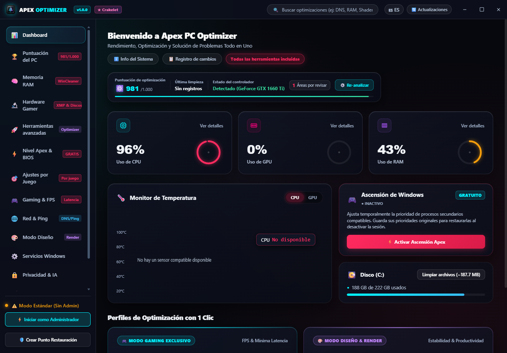
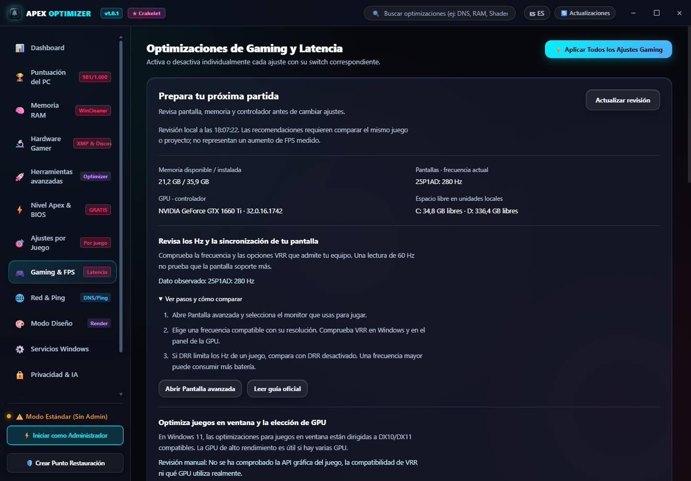
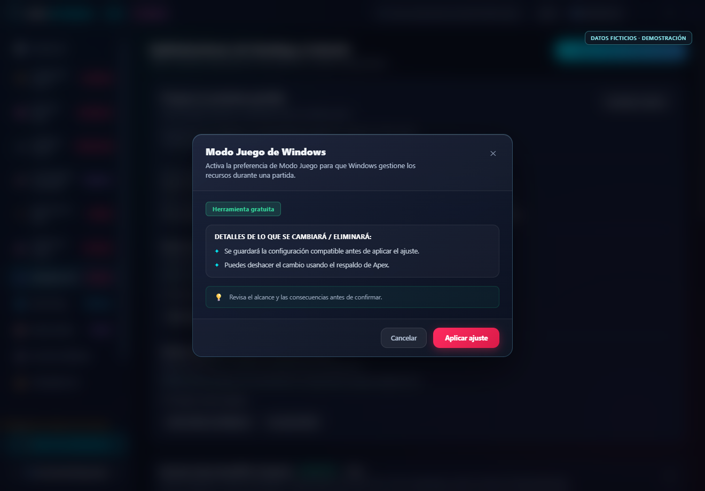

<p align="center"></p>
<h1 align="center">Apex PC Optimizer</h1>
<p align="center"><strong>Tu suite de Windows para gaming, creación y uso diario.</strong></p>
<p align="center">Interfaz glassmorphism, herramientas gratuitas y cambios que revisas antes de aplicar.</p>
<p align="center"><a href="https://github.com/Crakelet/apex-pc-optimizer/releases">Descargas</a> · <a href="#herramientas-incluidas">Herramientas</a> · <a href="#respaldos-y-límites-de-la-restauración">Respaldos</a> · <a href="#licencia-mit">Licencia MIT</a> · <a href="CONTRIBUTING.md">Contribuir</a></p>


[](https://github.com/Crakelet/apex-pc-optimizer/actions/workflows/ci.yml)

**Estado de seguridad:** los binarios están sin firma y la alerta comunicada de Bitdefender sigue en investigación. El código, las pruebas y sus límites se publican para revisión; no hay un falso positivo confirmado ni una aprobación de SignPath. Consulta [la investigación](docs/ANTIVIRUS.md), [Privacidad](PRIVACY.md) y [Code signing policy](CODE_SIGNING_POLICY.md).

La preparación de la candidatura y las evidencias pendientes están en [SignPath Foundation](docs/SIGNPATH_READINESS.md). Publicar en GitHub inicia un historial verificable; no elimina por sí solo una detección ni concede reputación de SmartScreen.

Apex reúne diagnóstico, ajustes de Windows, memoria, red, limpieza y perfiles de juegos en su diseño original de paneles de cristal, iluminación sutil y navegación lateral. **Todas las herramientas actuales son gratuitas y están disponibles en la app.** No hay una activación Pro, checkout ni selección de funciones de pago en esta versión.



Las capturas son demostraciones con datos ficticios; no muestran un equipo ni perfiles reales. Consulta [cómo se preparan](docs/images/README.md).

## Descargar y empezar

Abre [GitHub Releases](https://github.com/Crakelet/apex-pc-optimizer/releases) y elige una publicación estable. Si no aparece ninguna, todavía no hay binarios públicos publicados.

La v1.0.4 ya superó la [compilación desde el historial público limpio](https://github.com/Crakelet/apex-pc-optimizer/actions/runs/41363159191). Sus ejecutables permanecen en borrador mientras se completa la revisión de antivirus. Consulta [Validación](docs/VALIDATION.md), la [revisión de privacidad de la publicación](docs/PUBLICATION_PRIVACY.md) y la [alerta de dependencia de compilación pendiente](docs/DEPENDENCY_REVIEW.md).

| Archivo | Uso |
| --- | --- |
| `Apex-PC-Optimizer-v1.0.4-Setup-x64.exe` | Instalador con acceso directo y desinstalación. |
| `Apex-PC-Optimizer-v1.0.4-Portable-x64.exe` | Ejecutable sin instalación. No necesita Node.js. |
| `SHA256SUMS.txt` | Huellas de integridad de los dos ejecutables. |

La v1 funciona en **modo normal con herramientas reales**, tanto desde Setup/Portable como desde `run.bat` o `npm start`. Abrir la app no aplica ajustes. Antes de una acción que modifica el equipo se muestra una confirmación con su efecto y consecuencias; los detalles técnicos quedan en un nivel secundario.

Algunas herramientas necesitan permisos de administrador o no son compatibles con todos los equipos. Un error de permisos o de compatibilidad se comunica como tal: no implica que la herramienta sea de pago. La app no cierra otros procesos Electron ni solicita elevación automáticamente al arrancar.

El historial y los respaldos se conservan en el perfil del usuario, también al usar el portable. No los borres si necesitas deshacer cambios. Desinstalar Apex no restaura automáticamente las preferencias de Windows.

Mientras se ejecuta una acción manual, Apex muestra su estado y espera a que termine antes de cerrar. En **Seguridad y Backup** puedes consultar la actividad reciente, sus resultados y un resumen de los respaldos disponibles. Si una acción quedó interrumpida, el historial lo identifica para que revises el estado antes de repetirla.

**Compatibilidad prevista:** Windows 10/11 x64 con Windows PowerShell 5.1. No hay compilación ARM64 ni x86 en esta entrega. Consulta en cada release las versiones de Windows y escenarios realmente probados; la validación local no equivale a una certificación en todos los equipos.

**Firma digital:** los builds sin certificado no tienen firma Authenticode y no se anuncian como verificados por Microsoft. Las notas de release deben indicar su estado de firma. No desactives protecciones para ejecutar el programa.

**Revisión de antivirus:** se está investigando una alerta de Bitdefender; no hay todavía un veredicto documentado sobre los binarios actuales. Se corrigieron prácticas concretas de PowerShell, Game Bar y HOSTS. Consulta [lo comprobado y los pasos pendientes](docs/ANTIVIRUS.md) antes de atribuir el aviso a un falso positivo.

## Herramientas incluidas

La navegación mantiene las **14 secciones originales**:

| Sección | Qué ofrece |
| --- | --- |
| Dashboard | Resumen del equipo, telemetría y accesos a herramientas. |
| Puntuación del PC | Checklist de ajustes y mantenimiento; no es un benchmark ni una predicción de FPS. |
| Memoria RAM | Estadísticas y herramientas de memoria, con resultados observados en lugar de cantidades inventadas. |
| Hardware Gamer | Información de memoria, almacenamiento y configuración USB; los datos no confirmados se identifican. |
| Herramientas avanzadas | Gestión de inicio, HOSTS y cachés de aplicaciones. |
| Nivel Apex & BIOS | Ajustes avanzados de energía/red y guías de hardware, sin garantía de mejora universal. |
| Ajustes por Juego | Catálogo de cinco juegos y 29 ajustes específicos, con respaldo para los cambios compatibles. |
| Gaming & FPS | Asistente de pantalla, GPU y recursos; preferencias de Windows relacionadas con juegos y captura. |
| Red & Ping | Mediciones, DNS y reparación de red bajo confirmación. |
| Modo Diseño | Asistente de Photoshop, Premiere y Blender; detección de aplicaciones, preferencias de GPU, tabletas y cachés regenerables. |
| Servicios Windows | Ajustes de servicios con contexto y permisos correspondientes. |
| Privacidad & IA | Preferencias de privacidad y componentes de Windows. |
| Limpiador Disco | Limpieza conservadora con vista previa y exclusiones de archivos de trabajo. |
| Seguridad & Backup | Respaldos, puntos de restauración y opciones para deshacer cambios compatibles. |

El catálogo general reúne **50 ajustes**, además de **7 opciones Snappy UI**. Las mejoras de seguridad conservan estas familias de herramientas; no sustituyen módulos existentes por una edición reducida.

### Ajustes de VALORANT

En **Ajustes por Juego**, cierra VALORANT y elige el perfil de configuración que quieres modificar. Cuando hay varios archivos, Apex exige una selección explícita; muestra la ubicación Windows/WindowsClient y su fecha de modificación, sin identificar la cuenta de Riot. La selección dura esta sesión y no modifica archivos por sí sola. Los archivos de solo lectura se identifican y sus atributos se conservan.

Apex solo cambia opciones que existen en el archivo elegido. Si tu versión guarda una opción en otra ubicación, modifícala desde el juego; la app explica el motivo y no añade claves supuestas. Los ajustes de registro mantienen su alcance y permisos propios; algunos necesitan el juego abierto para detectar su ejecutable.

Después de aplicar un ajuste se actualiza su estado y respaldo, para poder restaurarlo desde el mismo control. **Restaurar respaldos** cubre los cambios propios de ese juego, incluidos los guardados en otros perfiles o por versiones anteriores. Requiere cerrar el juego para recuperar archivos; los conflictos externos detienen la operación y conservan el historial. No borres ese historial para eludir un error.


Apex no promete porcentajes de FPS, «latencia cero» ni que activar todos los ajustes sea lo adecuado. Los resultados dependen del hardware, del software, de Windows y del uso del equipo.

En **Gaming & FPS** y **Modo Diseño**, pulsa **Revisar mi equipo** para consultar memoria, pantalla, GPU/controlador y espacio local. El asistente distingue los datos observados de los ajustes que debes comprobar dentro de cada aplicación; ofrece pasos y guías oficiales. Es gratuito, no ejecuta un benchmark ni cambia Windows o tus proyectos al consultar. Consulta [la metodología y las fuentes de rendimiento](docs/PERFORMANCE.md).



Cada cambio muestra su alcance antes de aplicarse. La captura siguiente es una demostración con datos ficticios:



### Datos reales y estados desconocidos

CPU, memoria y almacenamiento utilizan lecturas del sistema. La temperatura de CPU no se estima a partir de la carga. Las lecturas de GPU dependen de las fuentes compatibles disponibles, como NVIDIA SMI; un sensor ausente se identifica.

La información de CIM no se trata como prueba definitiva de XMP/EXPO, canales de RAM o tasa de sondeo de un ratón. Cambiar la suspensión selectiva USB no demuestra una tasa de sondeo determinada. Las mediciones de red tampoco equivalen al ping dentro de una partida.

## Respaldos y límites de la restauración

El alcance depende de la herramienta:

| Tipo de cambio | Respaldo y restauración |
| --- | --- |
| Ajustes generales compatibles | Se guardan los valores originales antes de modificar registro, servicios u otras opciones admitidas por el motor. La reversión usa esos respaldos, no supuestos valores de fábrica. |
| Ajustes por juego compatibles | Se restauran únicamente cambios con respaldo propio de Apex, siguiendo el orden inverso real de aplicación. Los archivos o valores originales se conservan; un conflicto externo detiene la restauración y mantiene el respaldo. |
| DNS | Se conserva la configuración previa de los adaptadores cubiertos para poder restaurarla según el alcance de la herramienta. |
| Programas de inicio | Se conserva el origen HKCU, HKLM o carpeta Inicio, en lugar de reactivar todo en una ubicación distinta. |
| Diseño, tabletas y USB | Los ajustes compatibles usan el mismo motor con respaldo del catálogo general. Al restaurar se recuperan sus valores previos, sin imponer valores de fábrica. |
| Preferencia GPU por aplicación | Se guarda la preferencia original de cada ejecutable. Su botón de restauración actúa únicamente sobre esa aplicación y rechaza conflictos externos. |
| Herramientas Apex | Energía, TCP y MSI guardan sus recursos compatibles y tienen una restauración propia en el panel Apex. La restauración del plan recupera el que estaba activo; puede conservar el plan creado por Apex. |
| Limpiezas y purgas | Son acciones de mantenimiento que pueden ser irreversibles. Los archivos eliminados no se recuperan con «Revertir todo». |

El motor conserva el respaldo antes de ejecutar un cambio compatible y comunica errores y resultados parciales. Las operaciones con historial propio no se mezclan con ajustes que ya existían antes de usar Apex. «Revertir todo» cubre el catálogo general y los ajustes compatibles de auditoría, diseño, USB y Snappy. Los juegos, DNS, preferencias GPU y herramientas Apex se restauran desde sus paneles. No es una restauración universal de Windows, de archivos borrados o de todas las herramientas de la suite.

Las limpiezas excluyen recuperación, autoguardados, proyectos y medios originales; no recorren enlaces de sistema y conservan archivos recientes. La limpieza creativa pide cerrar las aplicaciones correspondientes. Se contabilizan los archivos realmente eliminados, no el tamaño previo de toda una carpeta.

El antiguo `tweaks_state.json` solo contenía estados booleanos. No permite reconstruir valores originales de acciones históricas. Los respaldos por operación tampoco sustituyen una copia de seguridad de Windows y de tus archivos personales.

El resumen de **Seguridad y Backup** reúne los ajustes generales, Snappy, Apex y juegos. DNS, GPU por aplicación, inicio y HOSTS conservan sus controles en su propia sección. El historial de actividad registra las acciones manuales y su resultado, sin guardar los argumentos enviados a las herramientas; no sustituye los archivos de respaldo. Las tareas de limpieza automática se consultan en **Memoria RAM**.

La creación de un punto de restauración se confirma comprobando que Windows haya registrado uno nuevo con la descripción solicitada. Si la protección del sistema, los permisos o el límite de frecuencia impiden confirmarlo, Apex muestra el fallo y no anuncia un punto creado.

Al cerrar normalmente, Apex detiene la limpieza automática de RAM, espera cualquier tarea de memoria pendiente e intenta recuperar las prioridades originales de Ascensión. Comprueba que el proceso y su prioridad sigan siendo compatibles con el respaldo; conserva los cambios externos y avisa si queda algo pendiente. Los ajustes permanentes de Windows se mantienen hasta que solicites su restauración.

## Privacidad y actualizaciones

No hay cuenta, analítica ni envío automático de inventarios. La interfaz utiliza recursos locales.

- Las pruebas de red contactan los destinos seleccionados por el usuario.
- «Comprobar actualizaciones» consulta `api.github.com` mediante HTTPS cuando lo solicitas. GitHub recibe los datos normales de una conexión, como IP y agente de usuario con la versión de Apex.
- Los enlaces abren el repositorio, sus publicaciones o las guías oficiales de Microsoft, Adobe, Blender y NVIDIA incluidas en el asistente. Se resuelven desde una lista fija; el renderer no puede enviar una URL arbitraria.
- Los accesos de pantalla, gráficos e inicio abren páginas concretas de Configuración de Windows. La elección y confirmación de sus cambios se hace dentro de Windows.

La actualización es **manual**: Apex no descarga ni ejecuta binarios por su cuenta. Los borradores y prereleases no se ofrecen como versiones estables. Consulta [el flujo de releases](docs/RELEASING.md).

El repositorio oficial es [Crakelet/apex-pc-optimizer](https://github.com/Crakelet/apex-pc-optimizer). Las contribuciones y revisiones quedan en su historial público. Los nuevos builds se preparan mediante GitHub Actions; las releases de evaluación se mantienen en borrador hasta que el mantenedor revise sus resultados y alertas. La procedencia de un build y una firma Authenticode son comprobaciones distintas.

## Licencia MIT

El código propio de esta versión se distribuye bajo [MIT](LICENSE), con copyright de Crakelet.

| Puedes… | Debes tener en cuenta… |
| --- | --- |
| Usarlo personal o comercialmente, gratis. | Se entrega sin garantía. |
| Leer, modificar y crear forks. | Conserva el aviso de copyright y el texto MIT al distribuir copias o partes sustanciales. |
| Redistribuirlo y vender copias o derivados. | MIT permite el uso comercial. |
| Mantener privadas tus modificaciones. | MIT no obliga a publicar el código de los derivados. |

MIT **no exige atribución visible dentro de la interfaz**. Apex mantiene el crédito «Proyecto original por Crakelet» voluntariamente y no añade esa condición a los forks. El texto vinculante es [LICENSE](LICENSE); también puedes consultar el [texto MIT de Open Source Initiative](https://opensource.org/license/mit).

Los componentes de terceros mantienen sus propias licencias; consulta [THIRD_PARTY_NOTICES.md](THIRD_PARTY_NOTICES.md). Cualquier decisión comercial se evaluará después, sin cambiar los permisos del código ya publicado bajo MIT. Hoy no hay funciones bloqueadas por pago.

## Ejecutar desde el proyecto

Requiere Node.js 22.12 o superior, npm y Windows x64.

```powershell
npm ci
npm start
```

`npm start` abre las fuentes en modo normal. **`run.bat`** también abre el modo normal y prefiere la aplicación compilada de `dist/win-unpacked`; si no está disponible, busca el portable y después Electron local. Para usar un ejecutable compilado no necesitas Node.js.

Para revisar la interfaz y confirmaciones sin aplicar cambios a Windows, abre **`run-tests.bat`** o usa:

```powershell
npm run start:test
# Alternativa: run.bat --test-mode
```

Este modo conserva diagnósticos reales, simula las acciones que modifican Windows y separa sus datos de los respaldos normales. La interfaz lo identifica con una franja visible. `npm run start:real` y `run.bat --real` se conservan como alias del arranque normal.

Las acciones reales requieren confirmación desde la interfaz. Valida los cambios de desarrollo que afecten a Windows en un entorno desechable con respaldos.

```powershell
npm run check          # Sintaxis y comprobaciones de la versión
npm test               # Motor, restauración, módulos, IPC, red y updates
npm run test:windows   # Integración con registro aislado de pruebas
npm run test:smoke     # Arranque y recorridos de interfaz en simulación
npm run test:release-startup # Arranque normal y cancelación, con mutaciones bloqueadas
npm run build          # Portable + instalador x64 + SHA256SUMS.txt
npm run verify:release # Revisa contenido, versión, huellas y estado de firma
```

La compilación conserva ambos formatos en `dist/`; generar uno no borra el otro. El build completo comprueba que las fuentes y recursos finales están en el paquete, contrasta las huellas y genera `signatures.json` y `release-manifest.json`. La firma requiere un certificado del responsable de la publicación. Las pruebas automatizadas no reemplazan la matriz manual de Windows, las comprobaciones después de reiniciar y la revisión del instalador.

`test:release-startup` consulta los backends reales, recorre la interfaz normal y cancela una confirmación. Usa datos separados y bloquea las acciones de modificación durante esa comprobación; no acredita haber aplicado optimizaciones reales.

Consulta el [resultado y alcance de la validación local](docs/VALIDATION.md).

## Ayuda y contribuciones

Lee [CONTRIBUTING.md](CONTRIBUTING.md), [SECURITY.md](SECURITY.md), el [registro de cambios](CHANGELOG.md) y la [dirección del proyecto](docs/ROADMAP.md). Al informar un problema, incluye versión, Windows y pasos para reproducirlo; elimina nombres de usuario, rutas privadas y comandos de inicio antes de compartir información.

Creado por [Crakelet](https://github.com/Crakelet).
